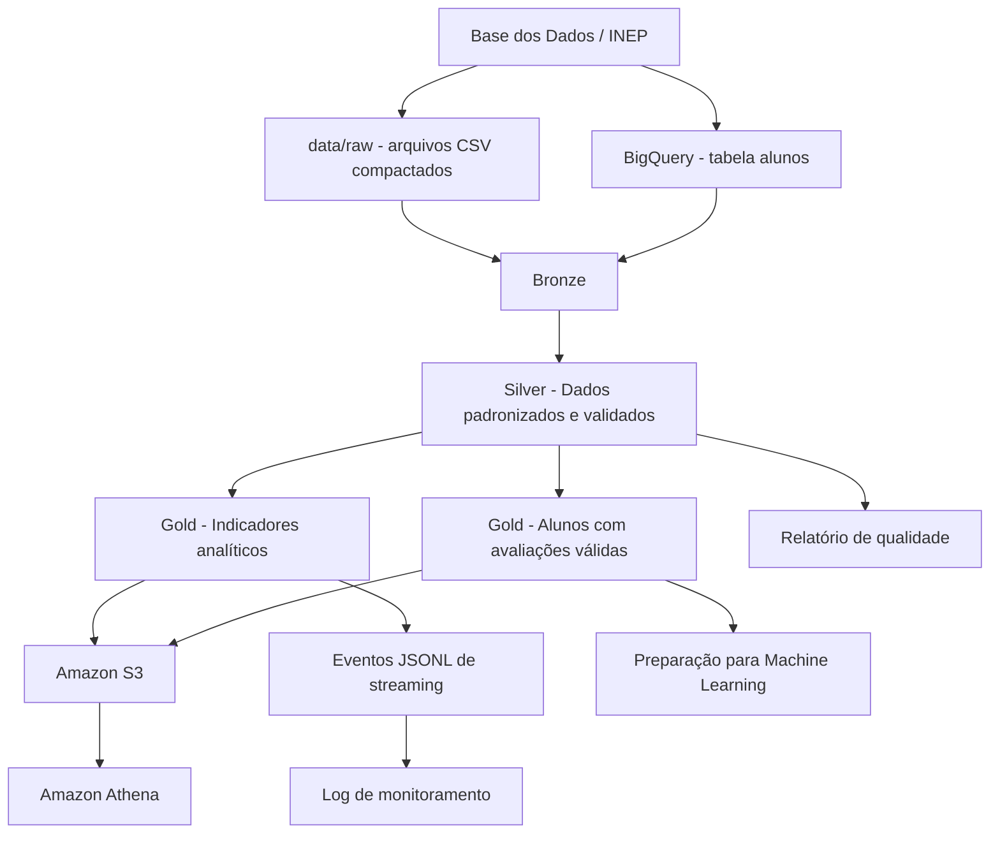

# Pipeline de Alfabetização no Brasil

Projeto iniciado no Tech Challenge — Fase 2 da pós-graduação em AI Scientist e evoluído na Fase 3 com a incorporação dos dados individuais de alunos para preparação das etapas de Machine Learning.

## Contexto do problema

A alfabetização na idade certa é um dos principais desafios da educação básica no Brasil. Quando uma criança não desenvolve habilidades adequadas de leitura e escrita nos primeiros anos escolares, isso pode impactar seu desempenho nas próximas etapas da trajetória escolar.

Neste projeto, a proposta é construir uma pipeline de dados para organizar, tratar e disponibilizar informações relacionadas à avaliação da alfabetização no Brasil.

A solução transforma dados brutos em bases analíticas que podem apoiar análises sobre desempenho educacional, metas de alfabetização, desigualdades territoriais e, na Fase 3, o desenvolvimento de modelos de Machine Learning para classificação da alfabetização no nível do aluno.

## Desafio educacional

O projeto utiliza dados oficiais relacionados à Avaliação da Alfabetização no Brasil.

Os dados permitem analisar informações como:

- percentual de alunos alfabetizados;
- média de proficiência em Língua Portuguesa;
- metas de alfabetização;
- desempenho por município e unidade da federação;
- participação dos alunos na avaliação;
- situação individual de alfabetização dos estudantes avaliados.

A partir desses dados, é possível responder perguntas como:

- quais UFs e municípios estão mais distantes das metas de alfabetização;
- quais redes apresentam melhores ou piores resultados;
- quais estados e municípios estão acima ou abaixo da referência nacional;
- quais características estão associadas à alfabetização dos alunos;
- como os dados tratados podem apoiar decisões e políticas públicas.

## Objetivo do projeto

O objetivo inicial do projeto foi construir uma pipeline de dados utilizando Arquitetura Medalhão, com camadas Bronze, Silver e Gold, ingestão batch, simulação de streaming, validações de qualidade, monitoramento, implementação em cloud e boas práticas de FinOps.

Na Fase 3, a solução é ampliada com a incorporação dos dados individuais de alunos, criando a base necessária para análise exploratória e desenvolvimento de modelos supervisionados de Machine Learning.

## Escopo do projeto

As principais tabelas utilizadas na pipeline são:

- `uf`: resultados observados da alfabetização por unidade da federação e rede de ensino;
- `meta_alfabetizacao_brasil`: metas e resultado consolidado em nível nacional;
- `meta_alfabetizacao_uf`: metas de alfabetização por UF até 2030;
- `municipio`: resultados observados da alfabetização por município e rede de ensino;
- `meta_alfabetizacao_municipio`: metas de alfabetização por município até 2030;
- `alunos`: dados individuais dos estudantes participantes da Avaliação da Alfabetização, incluindo presença, preenchimento da prova, classificação de alfabetização, proficiência e peso amostral.

## Arquitetura proposta

A solução foi organizada seguindo a Arquitetura Medalhão:

- **Bronze**: armazenamento dos dados próximos da fonte original;
- **Silver**: padronização, organização e validação dos dados;
- **Gold**: criação de tabelas analíticas prontas para consumo.

Além disso, a solução inclui:

- ingestão batch;
- simulação de eventos streaming;
- logs de monitoramento da pipeline;
- armazenamento em AWS S3;
- consulta das tabelas Gold com Amazon Athena;
- ingestão da tabela de alunos via BigQuery;
- preparação dos dados para Machine Learning.

## Diagrama da pipeline



## Fluxo de dados

O fluxo da pipeline funciona da seguinte forma:

1. As tabelas agregadas são obtidas da Base dos Dados e armazenadas em `data/raw` como arquivos CSV compactados.
2. A tabela individual `alunos` é consultada diretamente via BigQuery.
3. A etapa Bronze salva os dados em Parquet e adiciona metadados de ingestão.
4. A etapa Silver padroniza nomes, tipos de dados e executa validações de qualidade.
5. A etapa Gold gera tabelas analíticas com indicadores de alfabetização e comparação com metas.
6. A Gold também cria uma base individual apenas com alunos que possuem avaliações válidas.
7. A etapa de streaming simula eventos operacionais da pipeline em formato JSONL.
8. O monitoramento gera um log tabular com status, etapa, tabela e registros processados.
9. As camadas são armazenadas no Amazon S3.
10. As tabelas analíticas podem ser disponibilizadas no Amazon Athena para consulta SQL.
11. Os dados individuais preparados serão utilizados nas próximas etapas de análise exploratória e Machine Learning.

## Estrutura utilizada pela pipeline

A estrutura abaixo representa os principais arquivos versionados e pastas utilizadas ou geradas durante a execução da pipeline.

```bash
data/
├── raw/
├── bronze/
├── silver/
├── gold/
├── streaming/
└── monitoring/

notebooks/
├── 00_data_audit_and_integration.ipynb
└── 01_exploracao_base_alfabetizacao.ipynb

src/
├── ingest_bronze.py
├── transform_silver.py
├── transform_gold.py
└── simulate_streaming_monitoring.py

sql/
└── create_athena_tables.sql

docs/
└── documentacao_tecnica.md
```

Os arquivos de dados e os arquivos gerados pela pipeline não são versionados no GitHub.

## Dados utilizados

Os dados foram obtidos a partir da Base dos Dados, no conjunto **Avaliação da Alfabetização**, produzido a partir de dados do INEP.

As tabelas agregadas utilizadas na Fase 2 foram baixadas manualmente em formato CSV compactado e armazenadas localmente na pasta `data/raw`.

Os arquivos esperados são:

```bash
br_inep_avaliacao_alfabetizacao_uf.csv.gz
br_inep_avaliacao_alfabetizacao_meta_alfabetizacao_brasil.csv.gz
br_inep_avaliacao_alfabetizacao_meta_alfabetizacao_uf.csv.gz
br_inep_avaliacao_alfabetizacao_municipio.csv.gz
br_inep_avaliacao_alfabetizacao_meta_alfabetizacao_municipio.csv.gz
```

### Dados individuais de alunos

Na Fase 3, a tabela individual `alunos` também foi incorporada ao pipeline.

Devido ao seu volume e à indisponibilidade do download manual gratuito, sua ingestão é realizada diretamente pela Base dos Dados via BigQuery.

A tabela utilizada é:

```text
basedosdados.br_inep_avaliacao_alfabetizacao.alunos
```

Ela contém as seguintes informações principais:

- ano;
- município;
- escola;
- aluno;
- caderno da avaliação;
- série;
- rede de ensino;
- presença;
- preenchimento da prova;
- classificação de alfabetização;
- proficiência;
- peso do aluno.

A tabela completa possui 3.867.999 registros referentes aos anos de 2023 e 2024.

## Configuração do BigQuery

Para realizar a ingestão da tabela de alunos, é necessário possuir um projeto no Google Cloud habilitado para consultas ao BigQuery.

O identificador do projeto deve ser informado por variável de ambiente:

```bash
export BD_BILLING_PROJECT_ID="seu-projeto-google-cloud"
```

Na primeira execução, pode ser necessário realizar a autenticação com a conta Google associada ao projeto.

Credenciais, tokens e identificadores pessoais não são armazenados no repositório.

## Documentação técnica

Além deste README, o projeto possui documentação técnica complementar com detalhes sobre as camadas da pipeline, regras de qualidade, tabelas Gold, simulação de streaming, monitoramento, AWS, Athena e limitações técnicas.

O arquivo está disponível em:

```bash
docs/documentacao_tecnica.md
```

## Tecnologias utilizadas

| Tecnologia | Uso no projeto | Justificativa |
|---|---|---|
| Python | Desenvolvimento dos scripts da pipeline | Linguagem flexível e adequada para processamento de dados e Machine Learning |
| Pandas | Leitura, transformação e validação | Facilita a manipulação das tabelas |
| Base dos Dados | Fonte dos dados educacionais | Disponibiliza dados públicos tratados e documentados |
| BigQuery | Consulta da tabela individual de alunos | Permite acessar a tabela completa sem download manual |
| Parquet | Armazenamento das camadas Bronze, Silver e Gold | Formato eficiente para armazenamento e consulta |
| JSONL | Simulação de eventos streaming | Formato simples para eventos operacionais |
| Git e GitHub | Versionamento | Permite acompanhar a evolução da solução com branches, commits e Pull Requests |
| AWS S3 | Armazenamento em cloud | Utilizado como data lake do projeto |
| Amazon Athena | Consulta analítica das tabelas Gold | Permite executar SQL diretamente sobre arquivos Parquet no S3 |

## Pipeline Bronze

A primeira etapa da pipeline realiza a ingestão das fontes de dados e salva os resultados em formato Parquet na pasta `data/bronze`.

As tabelas agregadas são lidas a partir dos arquivos da pasta `data/raw`, enquanto a tabela `alunos` é consultada diretamente via BigQuery.

Nesta camada, os dados são mantidos próximos da fonte original.

Também são adicionados metadados de ingestão:

- `data_ingestao`: data e hora em que os dados foram processados;
- `arquivo_origem`: identificação da fonte utilizada na ingestão.

Tabelas processadas na Bronze:

- `uf`;
- `meta_alfabetizacao_brasil`;
- `meta_alfabetizacao_uf`;
- `municipio`;
- `meta_alfabetizacao_municipio`;
- `alunos`.

A tabela `alunos` possui 3.867.999 registros na Bronze.

Para executar a etapa:

```bash
python src/ingest_bronze.py
```

Para a ingestão de `alunos`, a variável `BD_BILLING_PROJECT_ID` deve estar definida.

## Pipeline Silver

A etapa Silver realiza a padronização das tabelas geradas na camada Bronze e cria um relatório de qualidade dos dados.

Nesta camada são realizadas transformações como:

- padronização de tipos;
- renomeação de colunas;
- padronização de identificadores;
- tratamento dos códigos categóricos;
- validação de duplicidades;
- validação de percentuais dentro do intervalo esperado.

Para a tabela `alunos`, identificadores e códigos categóricos são convertidos para tipos adequados e todos os registros da fonte continuam preservados.

A chave:

```text
ano + id_aluno
```

é utilizada para validar duplicidades da tabela individual.

Na execução atual, não foram encontradas duplicidades nessa chave.

O relatório de qualidade é salvo em:

```bash
data/silver/quality_report_silver.csv
```

Para executar:

```bash
python src/transform_silver.py
```

## População válida de alunos

Nem todos os registros da tabela `alunos` representam avaliações efetivamente realizadas.

Foram identificadas três situações principais:

- aluno ausente;
- aluno presente, mas sem prova preenchida;
- aluno presente com prova preenchida.

Para o problema de classificação da alfabetização, são considerados apenas os alunos que atendem simultaneamente às condições:

```text
presenca = 1
preenchimento_caderno = 1
```

Essa decisão evita classificar um aluno não avaliado como não alfabetizado.

Dos 3.867.999 registros disponíveis:

```text
3.354.661 possuem avaliações válidas
513.338 não possuem avaliação válida
```

Os registros não avaliados continuam preservados nas camadas Bronze e Silver.

## Variável-alvo

A variável:

```text
alfabetizado
```

será utilizada como target do problema de classificação da Fase 3.

Os valores são:

```text
0 = não alfabetizado
1 = alfabetizado
```

Entre as avaliações válidas, a distribuição observada foi:

```text
2023
0 = 625.382
1 = 877.427

2024
0 = 744.733
1 = 1.107.119
```

As duas classes possuem representação relevante nos dados.

## Proficiência e vazamento de informação

A variável `proficiencia` está diretamente relacionada ao resultado da avaliação utilizado para determinar se o aluno é alfabetizado.

Por isso, ela poderá ser utilizada durante análise exploratória e validação dos dados, mas **não será utilizada como variável explicativa do modelo de classificação**, evitando vazamento de informação entre as features e o target.

O mesmo cuidado será aplicado às variáveis agregadas da Gold que representam resultados da mesma avaliação, como taxa de alfabetização e média de proficiência.

## Pipeline Gold

A etapa Gold gera tabelas analíticas utilizadas para exploração e consumo dos dados.

Atualmente são produzidas cinco saídas principais:

- `indicadores_alfabetizacao_uf`;
- `indicadores_alfabetizacao_municipio`;
- `comparativo_metas_uf_brasil`;
- `comparativo_metas_municipio_brasil`;
- `alunos_avaliacoes_validas`.

### indicadores_alfabetizacao_uf

Contém:

- taxa de alfabetização;
- média de Língua Portuguesa;
- distância em relação ao ponto de corte de 743 pontos;
- classificação em relação ao ponto de corte.

### indicadores_alfabetizacao_municipio

Aplica a mesma lógica em nível municipal.

### comparativo_metas_uf_brasil

Permite comparar:

- resultado observado da UF;
- meta correspondente;
- resultado nacional;
- participação.

### comparativo_metas_municipio_brasil

Permite comparar:

- resultado observado do município;
- meta correspondente;
- referência nacional;
- participação.

### alunos_avaliacoes_validas

A tabela:

```text
data/gold/alunos_avaliacoes_validas.parquet
```

contém apenas alunos presentes e com prova preenchida.

Foram gerados:

```text
3.354.661 registros
```

Essa tabela representa a população válida que será utilizada como ponto de partida para as próximas etapas da Fase 3.

Ela ainda **não representa a base final de modelagem**, pois as variáveis territoriais, socioeconômicas e contextuais ainda serão selecionadas e integradas antes do treinamento dos modelos.

Para executar a Gold:

```bash
python src/transform_gold.py
```

## Streaming e Monitoramento

Como os dados oficiais de alfabetização são publicados de forma periódica, a ingestão principal foi tratada como batch.

Para representar a parte streaming, foi criada uma simulação de eventos operacionais da pipeline.

O script:

```bash
src/simulate_streaming_monitoring.py
```

gera eventos em formato JSONL para situações como:

- ingestão Bronze concluída;
- transformação Silver concluída;
- validação de qualidade concluída;
- atualização das tabelas Gold;
- execução geral da pipeline finalizada.

Além dos eventos JSONL, também é gerado um log tabular de monitoramento com informações como:

- etapa;
- status;
- tabela;
- quantidade de registros processados.

Arquivos gerados:

```bash
data/streaming/pipeline_events.jsonl
data/monitoring/pipeline_monitoring_log.csv
```

Para executar:

```bash
python src/simulate_streaming_monitoring.py
```

## Qualidade dos dados

As validações de qualidade são realizadas principalmente na camada Silver.

As regras implementadas verificam:

- duplicidade nas chaves principais;
- percentuais fora do intervalo esperado;
- unicidade da combinação `ano + id_aluno` na tabela individual de alunos.

O resultado é salvo em:

```bash
data/silver/quality_report_silver.csv
```

Na execução atual, a validação de duplicidade dos alunos retornou:

```text
status: ok
qtd_ocorrencias: 0
```

## Como executar a pipeline

Crie e ative o ambiente virtual:

```bash
python3 -m venv .venv
source .venv/bin/activate
```

Instale as dependências:

```bash
pip install -r requirements.txt
```

Configure o projeto utilizado pelo BigQuery:

```bash
export BD_BILLING_PROJECT_ID="seu-projeto-google-cloud"
```

Com o ambiente virtual ativado, execute:

```bash
python src/ingest_bronze.py
python src/transform_silver.py
python src/transform_gold.py
python src/simulate_streaming_monitoring.py
```

## Implementação em Cloud

A implementação em cloud utiliza:

- Amazon S3 para armazenamento das camadas;
- Amazon Athena para consultas SQL sobre tabelas analíticas.

As camadas estão organizadas no S3 da seguinte forma:

```bash
s3://pipeline-alfabetizacao-brasil-vitoria-20260830/raw/
s3://pipeline-alfabetizacao-brasil-vitoria-20260830/bronze/
s3://pipeline-alfabetizacao-brasil-vitoria-20260830/silver/
s3://pipeline-alfabetizacao-brasil-vitoria-20260830/gold/
s3://pipeline-alfabetizacao-brasil-vitoria-20260830/streaming/
s3://pipeline-alfabetizacao-brasil-vitoria-20260830/monitoring/
```

Com a evolução da Fase 3 também foram armazenados:

```text
bronze/alunos.parquet
silver/alunos.parquet
silver/quality_report_silver.csv
gold/alunos_avaliacoes_validas.parquet
```

## Amazon Athena

As tabelas Gold da Fase 2 foram disponibilizadas no Athena como tabelas externas apontando para arquivos Parquet armazenados no S3.

Os comandos SQL estão em:

```bash
sql/create_athena_tables.sql
```

As tabelas atualmente configuradas no Athena são:

- `alfabetizacao_brasil.indicadores_alfabetizacao_uf`;
- `alfabetizacao_brasil.indicadores_alfabetizacao_municipio`;
- `alfabetizacao_brasil.comparativo_metas_uf_brasil`;
- `alfabetizacao_brasil.comparativo_metas_municipio_brasil`.

A nova base individual da Fase 3 já está armazenada no S3, mas sua disponibilização no Athena será realizada posteriormente, juntamente com a definição da base analítica final utilizada no Machine Learning.

## Decisões arquiteturais

### Batch vs Streaming

Os dados oficiais de alfabetização são publicados de forma periódica, por isso a ingestão principal foi implementada como batch.

A parte streaming foi representada por eventos operacionais da própria pipeline.

Essa escolha evita representar artificialmente os dados educacionais como uma fonte atualizada em tempo real, ao mesmo tempo que demonstra como uma arquitetura poderia acompanhar eventos de execução e monitoramento.

### Data Lake vs Data Warehouse

A solução utiliza uma abordagem de data lake no Amazon S3.

Os dados são organizados em camadas e armazenados principalmente em arquivos Parquet.

Para consultas analíticas, o Athena permite consultar os arquivos diretamente no S3 utilizando SQL, sem necessidade de manter banco de dados ou cluster ativo permanentemente.

### Custo vs Performance

O projeto prioriza uma arquitetura simples e de baixo custo, compatível com o ambiente AWS Academy.

O uso de Parquet reduz o volume de dados lido pelo Athena e melhora a eficiência das consultas.

Também foram evitados recursos persistentes mais caros, como:

- EC2;
- EMR;
- Glue Jobs;
- clusters permanentes.

## Monitoramento e FinOps

O monitoramento foi implementado através de eventos JSONL e um log tabular da execução da pipeline.

O log registra informações como:

- etapa executada;
- status;
- tabela processada;
- quantidade de registros;
- resultado das validações.

O controle de custos é realizado principalmente através das escolhas arquiteturais.

Foram adotadas práticas como:

- uso de arquivos Parquet;
- organização dos dados em camadas;
- uso do S3 como armazenamento principal;
- uso do Athena apenas para consultas analíticas;
- ausência de recursos computacionais persistentes;
- bloqueio de acesso público ao bucket;
- desativação de versionamento quando não necessário ao escopo do projeto.

Essas decisões ajudam a manter o projeto simples e compatível com o ambiente AWS Academy.

## Preparação para Machine Learning

A Fase 3 utiliza os dados preparados pela pipeline como base para um problema supervisionado de classificação.

O objetivo será prever se um aluno é:

```text
alfabetizado
ou
não alfabetizado
```

A população inicial utilizada para esse problema corresponde aos alunos presentes e com avaliação preenchida.

A próxima etapa do projeto inclui:

- análise exploratória dos dados;
- análise da distribuição do target;
- seleção das variáveis explicativas;
- integração de informações territoriais e socioeconômicas;
- tratamento de valores ausentes;
- definição de variáveis categóricas e numéricas;
- prevenção de data leakage;
- construção do pipeline de preprocessing;
- treinamento e comparação de modelos;
- avaliação da capacidade de generalização;
- análise de Feature Importance;
- análise de interpretabilidade com SHAP.

## Cuidados com data leakage

Algumas variáveis disponíveis na fonte são diretamente relacionadas ao resultado da alfabetização.

Por isso, nem todas poderão ser utilizadas como features.

Entre as variáveis que exigem cuidado estão:

- proficiência individual;
- taxa de alfabetização agregada do mesmo período;
- média de proficiência agregada do mesmo período;
- distância do desempenho em relação ao ponto de corte.

Essas informações podem ser úteis para análise exploratória, mas sua utilização como entrada do modelo poderia fornecer ao algoritmo informações derivadas direta ou indiretamente do próprio resultado que ele deve prever.

A seleção final das features será realizada antes do treinamento.

## Análises territoriais

As tabelas agregadas construídas na Fase 2 continuam importantes para a Fase 3.

Elas permitem analisar:

- diferenças entre municípios;
- diferenças entre UFs;
- desempenho das redes de ensino;
- distância em relação às metas;
- comparação com resultados nacionais;
- municípios potencialmente em maior risco educacional.

Essas informações também poderão apoiar a criação de variáveis contextuais para os modelos.

## Políticas públicas baseadas em dados

A integração entre informações individuais e territoriais pode apoiar análises voltadas à priorização de políticas públicas.

Entre as possibilidades estão:

- identificação de regiões com maior concentração de alunos não alfabetizados;
- identificação de características associadas à alfabetização;
- análise de municípios com risco educacional;
- acompanhamento das metas de alfabetização;
- comparação entre regiões com características semelhantes.

## Boas práticas de Git

O projeto é desenvolvido utilizando branches separadas e Pull Requests para organizar sua evolução.

Entre as principais etapas versionadas estão:

- configuração inicial;
- pipeline Bronze;
- pipeline Silver e qualidade;
- pipeline Gold;
- streaming e monitoramento;
- documentação de AWS, Athena e FinOps;
- correções da camada Gold;
- integração dos dados individuais de alunos;
- preparação para a Fase 3.

Essa estratégia permite manter o histórico das decisões e alterações realizadas ao longo do projeto.

## Notebooks

### `00_data_audit_and_integration.ipynb`

Documenta a auditoria das tabelas herdadas da Fase 2 e a integração dos dados individuais de alunos.

Entre os pontos registrados estão:

- inventário da camada Gold;
- granularidade das tabelas;
- qualidade dos dados;
- incorporação da tabela `alunos`;
- definição da população com avaliação válida;
- distribuição da variável-alvo;
- cuidados relacionados a vazamento de informação.

### `01_exploracao_base_alfabetizacao.ipynb`

Notebook destinado à exploração dos dados de alfabetização.

Seu conteúdo será evoluído durante a Fase 3 para apoiar a análise exploratória necessária antes da modelagem.

## Observações e limitações

Os arquivos de dados brutos e os arquivos gerados nas camadas Bronze, Silver, Gold, Streaming e Monitoring não são versionados no GitHub.

A tabela individual `alunos` possui aproximadamente 3,8 milhões de registros. Por isso, o projeto utiliza Parquet para reduzir tamanho de armazenamento e melhorar eficiência de leitura.

Os alunos ausentes ou sem prova preenchida não são utilizados como exemplos de alunos não alfabetizados. Esses registros representam alunos não avaliados e permanecem preservados nas camadas anteriores da pipeline.

A base `alunos_avaliacoes_validas` ainda não representa a base final de Machine Learning. A seleção e integração das variáveis explicativas será realizada nas próximas etapas da Fase 3.

A variável `proficiencia` não será utilizada diretamente como feature do modelo de alfabetização por representar uma informação fortemente relacionada à definição do próprio target.

A parte de streaming continua implementada como simulação de eventos operacionais da pipeline, pois os dados oficiais de alfabetização são publicados periodicamente e não representam um fluxo contínuo de eventos em tempo real.

## Status atual

Até o momento, foram concluídas:

- construção da pipeline Bronze, Silver e Gold da Fase 2;
- implementação de qualidade de dados;
- implementação em AWS S3;
- consultas analíticas utilizando Athena;
- simulação de streaming e monitoramento;
- correção da integração entre referências municipais e nacionais na Gold;
- acesso à tabela individual de alunos via BigQuery;
- ingestão dos 3.867.999 registros de alunos na Bronze;
- padronização dos dados individuais na Silver;
- validação da chave `ano + id_aluno`;
- definição da população com avaliação válida;
- criação da Gold `alunos_avaliacoes_validas` com 3.354.661 registros;
- armazenamento das novas tabelas no Amazon S3;
- documentação da integração para início da Fase 3.

As próximas etapas correspondem à construção da base analítica final, análise exploratória e desenvolvimento dos modelos de Machine Learning.